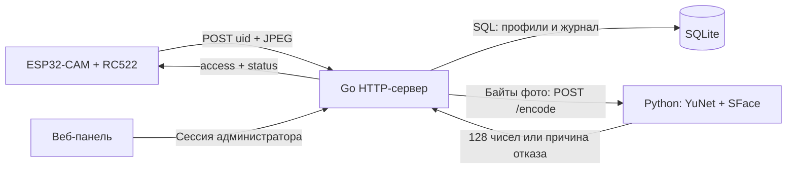

# Документация по коду

## 1. Архитектура



**Go** отвечает за карту, доступность сотрудника, хранение, сравнение лица, аудит и HTTP-контракт. **Python** отвечает только за извлечение признаков из изображения. **Веб-панель** вызывает те же административные ручки, что описаны в [API.md](API.md). Никаких решений об открытии двери в браузере не принимается.

Бэкенд использует стандартный `net/http`: для небольшого проекта отдельный маршрутизатор не нужен. SQLite-драйвер `modernc.org/sqlite` работает без CGO, поэтому для сборки сервера не требуется компилятор C.

## 2. Структура проекта

```text
cmd/server/main.go                 Точка входа и завершение сервера
internal/app/
  config.go                        Конфигурация и случайные секреты
  app.go                           Маршруты, HTTP-обработчики, валидация
  auth.go                          Сессии, вход/выход, проверка origin
  store.go                         SQLite, схемы, запросы, аудит
  face.go                          Клиент Python и косинусное сравнение
  app_test.go                      Тесты правил доступа и API
  web/index.html                   Разметка панели и диалогов
  web/styles.css                   Дизайн, адаптация, состояния
  web/app.js                       Вход, загрузка данных, формы, навигация
face-service/
  app.py                           FastAPI и ограничение нагрузки
  recognizer.py                    Декодирование и нейросетевые векторы
  model_manifest.py                Имена, размеры и SHA-256 моделей
  download_models.py               Проверяемая загрузка моделей
  requirements.txt                 Прямые Python-зависимости
  requirements.lock.txt            Все зафиксированные Python-зависимости
  test_recognizer.py               Тесты изображений и EXIF
  Dockerfile                       Контейнер Python
scripts/
  setup.ps1                        Установка и сборка для Windows
  start.ps1                        Запуск и остановка пары сервисов
  access_client.py                 Клиент контракта ESP32
  smoke_test.py                    Сквозной тест настоящего SFace
  browser_test.cjs                 Проверка панели в браузере
Dockerfile                         Контейнер Go
compose.yaml                       Два сервиса и постоянный том SQLite
go.mod / go.sum                    Go-зависимости и контрольные суммы
package.json / package-lock.json   Только зависимости браузерных тестов
docs/                              Документация
```

Генерируемые каталоги `.venv`, `.gocache`, `.runtime`, `data`, `bin` и модели `.onnx` исключены из Git. Node.js требуется для браузерных тестов; сервер и панель работают без него.

## 3. Точка входа и конфигурация

`cmd/server/main.go` выполняет `LoadConfig()` → `OpenStore()` → `New()` → `Handler()`, затем запускает `http.Server`. На SIGTERM/Ctrl+C используется `Shutdown` с бюджетом 5 секунд, после чего закрывается база.

HTTP-сервер ограничивает время чтения заголовков 5 секундами, чтения запроса 20 секундами, записи ответа 25 секундами, простой соединения 60 секундами и размер заголовков 16 КиБ.

`config.go`:

| Символ | Назначение |
|---|---|
| `Config` | Адрес, база, URL Python, пароль, ключ устройства, порог, режим cookie |
| `LoadConfig` | Читает окружение и проверяет порог, длину пароля и абсолютный HTTP(S)-URL Python |
| `env` | Возвращает непустое значение окружения или значение по умолчанию |
| `randomToken` | Генерирует криптографически случайные байты и кодирует hex; применяется к паролю и сессиям |
| `moscow` | Фиксированное UTC+3 для статистики и фильтра даты |

Случайный пароль генерируется при отсутствии `ADMIN_PASSWORD` и выводится только на старте. Существующий пароль из окружения не логируется. Ошибка конфигурации прекращает запуск, а не подменяет настройку молча.

## 4. HTTP-слой

`app.go` содержит `App`: ссылки на конфигурацию, хранилище, клиент Python и состояние авторизации. `New` собирает зависимости; `Handler` регистрирует маршруты с указанием HTTP-метода.

Папка `web` включается в бинарный файл через `go:embed`. HTML, CSS и JS раздаются самим Go. HTTP-заголовки запрещают встраивание страницы во фрейм, MIME-sniffing и загрузку скриптов с внешних источников. `Cache-Control: no-store` предотвращает кэширование административных данных.

Вспомогательные функции:

- `writeJSON` — установка JSON MIME-типа, HTTP-кода и сериализация ответа.
- `apiError` — единый формат `{error,message}` для административного API.
- `readJSON` — до 8 КиБ, запрет неизвестных полей и второго JSON-объекта.
- `parseForm` — общий лимит multipart-тела; после обработки вызывается `RemoveAll`.
- `photoBytes` — ровно один файл, проверка размера и фактического формата/размеров через `image.DecodeConfig`; тип не определяется только расширением файла.
- `pathID` — положительный int64 из параметра маршрута.
- `mutationError` — различает отсутствующую запись и ошибку базы.

Административные обработчики `users`, `createUser`, `updateUser`, `deleteUser`, `logs`, `stats`, `health` выполняют валидацию и вызывают хранилище. Правила и формы ответа описаны в [API.md](API.md).

## 5. Проверка прохода

Обработчик `access` проходит следующие шаги:

1. При настроенном ключе проверяет `X-Device-Key`; альтернативой является административная сессия с допустимым origin.
2. Читает ограниченное multipart-тело, проверяет точный набор полей.
3. Проверяет UID. Некорректный номер не сохраняется в журнал как UID.
4. Читает профиль по карте. Неизвестная и заблокированная карта отклоняются без обращения к Python.
5. Проверяет JPEG и передаёт его байты в `FaceClient.Encode`.
6. Обрабатывает отсутствие лица, несколько лиц, сбой Python и некорректный вектор.
7. Проверяет сохранённый вектор и вычисляет косинусное сходство. При сходстве ниже порога выдаёт отказ.
8. Вызывает `RecordDecision`: перед успехом карта повторно проверяется в транзакции, затем сохраняется журнал.
9. Возвращает строго `{access,status}` с HTTP 200.

Вложенная функция `finish` использует отдельный контекст с таймаутом 3 секунды для аудита. Это позволяет попытаться записать событие даже после отключения клиента. Если аудит не записался, итог становится `server_error`, `access=false`.

Проверка при записи устраняет окно между начальным чтением профиля и распознаванием: если карту успели заблокировать/удалить или удалить и заново зарегистрировать под тем же UID, успешный результат распознавания не даёт проход. После зафиксированного решения блокировка влияет на последующие проверки: уже отправленную команду устройство должно обрабатывать самостоятельно.

## 6. Работа с лицами

### Python: recognizer.py

`decode_photo` читает JPEG/PNG с помощью Pillow, проверяет байтовый и пиксельный лимит, запрещает слишком маленькие изображения и декомпрессионные бомбы. `ImageOps.exif_transpose` учитывает ориентацию телефонных фотографий. RGB преобразуется в BGR для OpenCV.

`Recognizer.__init__` читает модели через `pathlib`, проверяет размеры/SHA-256 по `model_manifest.py` и создаёт OpenCV-объекты **из буферов**. Это устраняет проблему нативных путей OpenCV с кириллицей в Windows. Модели загружаются один раз на процесс.

`Recognizer.encode`:

1. Декодирует изображение; при стороне длиннее 1280 пикселей пропорционально уменьшает кадр.
2. Под блокировкой устанавливает размер входа YuNet и обнаруживает лица. Порог детектора 0.9, NMS 0.3.
3. Требует ровно одно лицо. Ни одно лицо не выбирается автоматически из группового снимка.
4. SFace выравнивает и обрезает лицо по найденным ориентирным точкам.
5. Извлекает 128 признаков, проверяет конечность и нормирует вектор по L2.

`FaceError` переносит машинный status из алгоритма в HTTP-обработчик. Непредвиденные исключения фиксируются в диагностическом журнале и превращаются в отказ.

### Python: app.py

`lifespan` создаёт `Recognizer` и семафор до запуска приложения. `/health` доступен после успешной загрузки моделей. `/encode` читает тело порциями и прекращает чтение при превышении лимита.

Нейросетевой расчёт запускается через `run_in_threadpool`, чтобы не блокировать событийный цикл FastAPI. Одновременно допускаются четыре задачи, включая ожидающие блокировку OpenCV; ожидание семафора ограничено двумя секундами. Внутри процесса доступ к изменяемым DNN-объектам сериализован `threading.Lock`. OpenCV использует два вычислительных потока. Рабочая конфигурация запускает один worker.

Python не хранит профили и не решает, открывать ли дверь. Он возвращает только признаки или причину, по которой их извлечение невозможно.

### Go: face.go

`FaceClient` использует переиспользуемый HTTP-клиент с таймаутом 15 секунд. `Encode` отправляет сырые байты фото, ограничивает ответ 64 КиБ и проверяет JSON/status. `Healthy` выполняет запрос готовности с контекстом вызывающей стороны.

`validEncoding` требует 128 конечных чисел и положительную конечную норму. `cosine` вычисляет:

```text
similarity = dot(reference, current) / (norm(reference) * norm(current))
```

Равенство порогу считается совпадением. Значение по умолчанию 0.363 взято из [официального примера OpenCV для SFace](https://docs.opencv.org/4.13.0/d0/dd4/tutorial_dnn_face.html). Это исходный порог сравнения для модели, а не обещание точности на кадрах конкретной ESP32 и не вероятность. Настройка требует выборки настоящих и чужих лиц в условиях вашей камеры.

Модели: [YuNet](https://github.com/opencv/opencv_zoo/tree/main/models/face_detection_yunet), [SFace](https://github.com/opencv/opencv_zoo/tree/main/models/face_recognition_sface). Их лицензии и файлы моделей предоставляются OpenCV Zoo; при распространении модели учитывайте лицензии соответствующих каталогов.

## 7. SQLite

`OpenStore` создаёт каталог и открывает SQLite, включает WAL и `busy_timeout=5000`. Пул ограничен одним соединением: это упрощает запись и транзакции в небольшом проекте. Длительный вызов распознавания выполняется без удержания транзакции/соединения.

Таблица `users`:

| Колонка | Тип/ограничение | Смысл |
|---|---|---|
| `id` | INTEGER PRIMARY KEY AUTOINCREMENT | Идентификатор конкретной регистрации |
| `full_name` | TEXT NOT NULL | Имя |
| `card_uid` | TEXT UNIQUE, длина 14 | Карта |
| `face_encoding` | TEXT NOT NULL | JSON-массив из 128 чисел |
| `is_active` | INTEGER, 0/1, default 1 | Разрешение прохода |
| `created_at` | TEXT NOT NULL | UTC-метка регистрации |

Таблица `logs`:

| Колонка | Тип | Смысл |
|---|---|---|
| `id` | INTEGER PRIMARY KEY AUTOINCREMENT | Порядок события |
| `timestamp` | TEXT NOT NULL | UTC-время решения |
| `card_uid` | TEXT NOT NULL | Проверявшаяся карта или пустая строка |
| `full_name` | TEXT NOT NULL | Снимок имени на момент события |
| `result` | TEXT NOT NULL | Машинный status |
| `duration_ms` | INTEGER NOT NULL | Время обработки до записи |

Индексы: уникальный индекс UID в `users`, `idx_logs_time`, `idx_logs_uid`. Журнал не имеет внешнего ключа на пользователя: неизвестные карты тоже должны попадать в историю, а удаление сотрудника не должно уничтожать события.

Времена хранятся в едином формате с девятью знаками долей секунды. Это позволяет корректно сравнивать текстовые UTC-метки на границах дня. Смешивать в SQL эти метки с сокращёнными строками без долей секунды не следует.

Функции хранилища:

| Функция | Действие |
|---|---|
| `scanUser` | Читает строку и десериализует вектор |
| `UserByUID` | Поиск профиля по карте |
| `Users` | Все профили, новые первыми |
| `CreateUser` | Сериализует вектор и создаёт активный профиль |
| `SetActive` / `DeleteUser` | Изменяет активность / удаляет профиль |
| `affected` | Отсутствие затронутой строки переводит в `sql.ErrNoRows` |
| `RecordDecision` | В транзакции повторно проверяет карту для успеха и записывает событие |
| `filterSQL` | Строит только фиксированные SQL-фрагменты; значения идут параметрами |
| `Logs` | Список и число событий с фильтрами/пагинацией |
| `Stats` | Текущие профили и события московского дня по часам |

SQL-функция `unicode_lower` зарегистрирована через драйвер и использует Go `strings.ToLower`. Обычный SQLite `lower()` не обеспечивает нужное поведение для кириллицы. SQL-значения UID, поиска и статусов всегда передаются параметрами, без конкатенации пользовательского ввода в запрос.

Начальная схема создаётся через `CREATE TABLE IF NOT EXISTS`. Это не полноценная система версионных миграций: при изменении существующих колонок нужно добавить явную миграцию и тест обновления старой базы.

## 8. Авторизация и HTTP-защита

`auth.go` хранит случайные идентификаторы сессий и срок действия в памяти под `sync.Mutex`. Истёкшие сессии и попытки входа очищаются при обращениях. Сессии не хранятся в SQLite.

- `sameSecret` сравнивает SHA-256 двух строк в постоянное время по фиксированному размеру, чтобы не сравнивать пароль по символам.
- `authorized` проверяет cookie и срок сессии.
- `sameOrigin` запрещает `Sec-Fetch-Site: cross-site`; если есть Origin, требует HTTP(S) и совпадение host с запросом.
- `admin` оборачивает административные ручки проверкой сессии, а изменения — ещё и origin.
- `login` ограничивает попытки с одного RemoteAddr и выдаёт cookie на восемь часов.
- `logout` удаляет токен и cookie.

Пароль берётся из окружения, в базе его нет. Cookie HttpOnly не позволяет JS прочитать токен. SameSite=Strict ограничивает отправку cookie с чужих сайтов. Для HTTPS развёртывания нужно включить `COOKIE_SECURE=true`; при локальном HTTP это отключено.

Веб-код экранирует динамические текстовые значения перед вставкой HTML. Изображения предварительного просмотра представлены локальными blob-URL. Панель не загружает сторонние CDN, шрифты или аналитические скрипты.

## 9. Фронтенд

Навигация использует hash `#journal`, `#users`, `#terminal`, поэтому не требует маршрутизации SPA на сервере. `state` хранит выбранную страницу, пагинацию, список сотрудников, состояние обновления и диалогов.

| Функции app.js | Назначение |
|---|---|
| `api` | Запрос JSON с cookie, единая обработка ошибок, выход при 401 |
| `showLogin` / `showApp` | Переключение экранов и запуск/остановка автообновления |
| `navigate` | hash-навигация, заголовок, активная ссылка |
| `loadLogs` | Фильтры/пагинация; счётчик запроса предотвращает перезапись нового результата старым |
| `loadUsers` / `renderUsers` | Загрузка и клиентский поиск; список не перерисовывается при неизменных данных |
| `loadStats` / `loadHealth` | Счётчики, график и состояние компонентов |
| `refresh` | Параллельное чтение независимых данных, контроль ошибок и повторных обновлений |
| `openUserDialog` / `setBusy` | Регистрация и блокировка повторной отправки формы |
| `escapeHTML` / `person` / `badge` | Безопасное отображение текста и статусов |
| `toast` / `debounce` | Уведомления и ограничение частоты поиска |
| `eventCount` | Русские формы «событие/события/событий» |

Формы отправляют `FormData` и JSON; multipart boundary задаёт браузер. Интерфейс не сравнивает лица и не хранит векторы. При ошибке регистрации форма сохраняет введённые данные для исправления.

`styles.css` содержит цветовые переменные, состояния кнопок/таблиц/диалогов и адаптивные правила для 1150, 850 и 600 пикселей. Таблицы на узком экране прокручиваются внутри своего контейнера; меню раскрывается отдельной кнопкой. Вёрстка учитывает `prefers-reduced-motion`.

## 10. Тесты и эксплуатационные ограничения

`app_test.go` проверяет контракт, аудит, запрещённые сценарии, ошибки стороннего сервиса, авторизацию, жизненный цикл профиля, блокировку во время распознавания, отказ при сломанном журнале, кириллический поиск и границы московской даты. Подменяется только Python-клиент внутри теста; рабочий сервер всегда использует настоящий сервис.

`test_recognizer.py` проверяет декодирование, лимиты и EXIF. `smoke_test.py` запускает настоящие Go/Python на изолированных портах и временной базе, выполняет реальную нейросетевую проверку и завершает созданные процессы. `browser_test.cjs` проверяет пользовательские действия в Edge и отсутствие JS/CSP-ошибок.

Для большой проходной понадобятся пагинация списка сотрудников, агрегаты статистики в SQL, обслуживание/срок хранения журнала, версионные миграции и распределённое хранилище сессий. Сейчас проект рассчитан на один экземпляр Go и небольшой объём данных.

Проверка живости, расписания допуска, роли нескольких администраторов, управление замком, шифрование базы и интеграция со сторонними системами в эту реализацию не входят. Фактическая точность и задержка на кадрах ESP32 должны быть проверены на устройстве.
